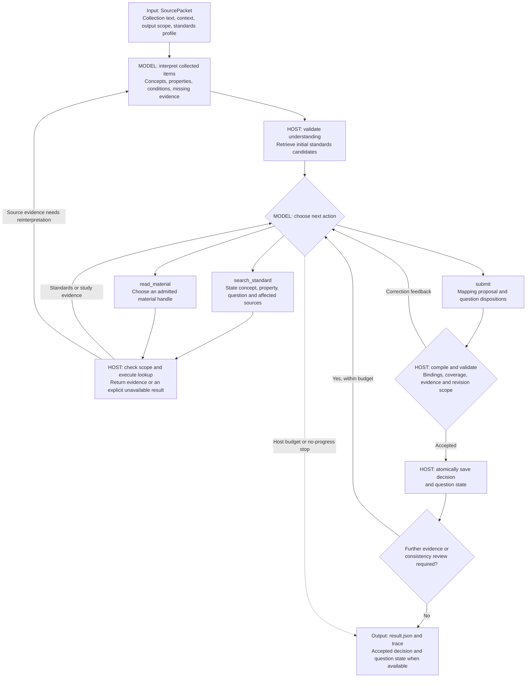
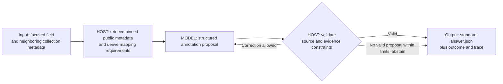

# Architecture: from collection evidence to a reviewable mapping

aCRF contains two related workflows. The **agentic `Session` workflow** lets a
model request evidence as it develops a mapping. The **measured standards-only
workflow** retrieves public metadata before asking for a structured annotation.
They have different input and output contracts; the 1,211-case benchmark in the
[README](../README.md#measured-results) evaluates the second workflow.

The diagrams below describe control flow in the implementation. They are not
transcripts of a model run.

## Agentic workflow

The input is a [`SourcePacket`](../pipeline/stage_b_mapper_module/annotation_workflow/source.py):
reviewed collection text, source objects and their relationships, an explicit
output scope, and a fixed study/standards profile. Neighboring objects can supply
context without becoming writable annotation subjects. The current `Session`
accepts `reviewed_text`; image input is not implemented in this path.

The model decides what to ask and whether to search, read, or submit. The host
owns tool execution, admitted handles, source permissions, validation, saved
state, and resource limits. Understanding can also request source material
before the initial candidate retrieval. Later source evidence can trigger
reinterpretation and retrieval; revisions must preserve unaffected judgments.

### What makes the search agentic

Each decision turn can select one of three typed
[actions](../pipeline/stage_b_mapper_module/annotation_workflow/evidence_actions.py):

| Action | Model supplies | Host enforces |
| --- | --- | --- |
| `search_standard` | A concept, collected property, affected sources, question and intended impact | Searches the pinned knowledge snapshot and returns actual candidates; the current backend uses SQLite full-text search with concept/property/context ranking |
| `read_material` | A delivered template alias or indexed material handle, plus the question it should resolve | Reads admitted material; a guessed document ID is rejected |
| `submit` | Proposed records, other source outcomes, and resolved/deferred question updates | Compiles and checks the proposal before committing the decision and question state |

Observations become input to the next model decision. This permits evidence
requests that depend on earlier results. It does not give the model arbitrary
filesystem, URL, or document access: `MaterialStore` and the delivered candidate
set define what it can read. An unavailable lookup remains visible, so the
model can defer a question instead of treating missing evidence as an answer.

The [`QuestionLedger`](../pipeline/stage_b_mapper_module/annotation_workflow/evidence_actions.py)
tracks `open`, `resolved`, and `deferred` questions. A resolution can cite only
evidence already delivered in the current context. A `resolved` label records
the model's disposition; the host's reference checks do not independently
establish that the interpretation is correct.

### Validation, stopping and output

The [`Session`](../pipeline/stage_b_mapper_module/annotation_workflow/session.py)
checks proposed source bindings, target records, conditions, evidence references
and coverage. Correction feedback identifies the affected sources. A correction
cannot silently delete an unrelated accepted binding, constant, or record
constraint to make the response pass.

Default budgets allow up to eight model calls, 4,800 output tokens per call,
a 60,000-token cumulative stopping threshold, 900 seconds, and 64,000 bytes of
candidate evidence. The host checks call, cumulative-token and elapsed-time
budgets before sending another request. Repeated evidence actions and repeated
failed corrections also stop the loop. If a run stops after a decision was
accepted, that decision remains available with the stop reason; without an
accepted decision, the run is `failed`.

| Artifact | What a reviewer can inspect |
| --- | --- |
| `result.json` | Run status (`proposal`, `partial`, or `failed`), stop reason, understanding, decision, issues, call count and token usage |
| `snapshot.json` | The latest authoritative accepted value; decision snapshots include the question ledger and that turn's updates in one atomic write |
| `review.md` | Human-readable rendering when an accepted decision is available |
| `question-ledger.json`, `decision-notes.md`, request/reply and lookup files | Questions, concise explanations, model actions, delivered evidence and validation feedback |

The [`MappingDecision`](../pipeline/stage_b_mapper_module/annotation_workflow/decision.py)
represents target observations and per-source annotations with dispositions
`mapped`, `context_only`, `not_submitted`, or `unresolved`. Source conditions and
target-record selectors remain separate. Semantic review and study approval
remain `pending`; a valid proposal does not become an approved study mapping.

[`RunStore`](../pipeline/stage_b_mapper_module/annotation_workflow/store.py)
publishes files atomically and refuses to overwrite an existing run directory.
The authoritative decision snapshot includes its question state. Supporting
artifacts are derived views, and automatic crash resume is not implemented.

## Measured standards-only workflow

[`run_standard`](../pipeline/stage_b_mapper_module/annotation_workflow/standard_annotation.py)
uses a focused blank field and its ordered neighbors. It retrieves context once,
then asks the model for an annotation under a native JSON Schema. The model
does not select search or read actions in this path.

[`StandardsCorpus`](../pipeline/stage_b_mapper_module/annotation_workflow/standard_context.py)
verifies the corpus profile and source hashes. Retrieval matches normalized
form/section names and collection wording, then supplies applicable mappings,
target definitions, companions, and specialization evidence. This is a
controlled public-template retrieval task; it has not established retrieval
coverage for arbitrary study wording.

The loop permits at most three proposal attempts within its call/token/time
limits. The answer preserves conditions, transformations, source bindings and
record identity, with status `mapped`, `partial`, `needs_convention`,
`not_submitted`, or `abstain`. `outcome.json` separately records
`completed_for_review` or `incomplete`. If no valid proposal is accepted, the
export contains `abstain` and no invented replacement facts.

The [input](../examples/standards_annotation/input.json) and
[output](../examples/standards_annotation/output.json) example belongs to this
measured path. Its full benchmark results do not establish the effectiveness
of the separate model-directed search workflow or a complete PDF-to-annotation
pipeline.

## Code and checks to inspect

| Engineering concern | Implementation | Focused checks |
| --- | --- | --- |
| Model-selected evidence tools | [Actions](../pipeline/stage_b_mapper_module/annotation_workflow/evidence_actions.py), [session controller](../pipeline/stage_b_mapper_module/annotation_workflow/session.py), [knowledge search](../pipeline/stage_b_mapper_module/annotation_workflow/knowledge.py) | [Action workflow](../tests/annotation_workflow/test_action_workflow.py) checks real SQLite lookups, invalid handles and unread evidence references with scripted model replies |
| Targeted recovery and state integrity | [Session revision handling](../pipeline/stage_b_mapper_module/annotation_workflow/session.py), [atomic store](../pipeline/stage_b_mapper_module/annotation_workflow/store.py) | [Recovery loop](../tests/annotation_workflow/test_recovery_loop.py), [question commit](../tests/annotation_workflow/test_question_commit.py), [source revision](../tests/annotation_workflow/test_source_revision.py) |
| Standards annotation contracts | [Annotation and validation](../pipeline/stage_b_mapper_module/annotation_workflow/standard_annotation.py), [wire schema adapter](../pipeline/stage_b_mapper_module/annotation_workflow/standard_wire.py) | [Standards run](../tests/annotation_workflow/test_standard_run.py), [requirements](../tests/annotation_workflow/test_standard_requirements.py), [wire contract](../tests/annotation_workflow/test_standard_wire.py) |

These controlled tests exercise orchestration and validation behavior. Scripted
model replies make failure cases reproducible; they do not measure a live model's
ability to choose the right evidence or prove a quality gain from agentic search.
